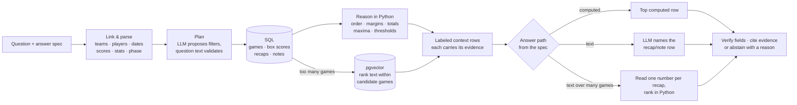

# NBA Season RAG

**Ask questions about the 2025-26 NBA season and get answers that cite their sources, or an explicit "I can't tell from the data."**

A local retrieval-augmented generation pipeline over real NBA box scores and play-by-play. It uses Postgres + pgvector for retrieval and a 2B-parameter model (`qwen3.5:2b` via Ollama) for the judgment calls. Python does all the counting, and every answer is checked against the rows it cites before it's returned.

**[Live results explorer →](https://trstewart-max.github.io/nba-rag/)**: every evaluated question with its answer, gold answer, cited evidence, and the exact context the model saw. To ask your own questions, [run it locally](#quickstart); the same page then gets a live **Ask** box.

<!-- RESULTS:START -->
| Question set | Questions | Accuracy | Wrong | Abstained wrongly | Answered the unanswerable | Evidence recall |
|---|---|---|---|---|---|---|
| **Test**: written after development, run once | 44 | **98%** | 1 | 0 | **0** | 0.97 |
| Held-out: run blind, then used to find bugs | 44 | 98% | 1 | 0 | 0 | 0.97 |
| Dev: developed against | 44 | 100% | 0 | 0 | 0 | 1.00 |

Across all 132 questions, including 15 that the data can't answer, the pipeline never returned an answer to an unanswerable question. The single test-set miss is kept as is (see [Failure analysis](#failure-analysis)).
<!-- RESULTS:END -->

## Why not just embed everything and ask the LLM?

The first version of this idea is "embed every game, retrieve the top-k, ask the model." It fails on almost every interesting question:

* **"How many points did Shai Gilgeous-Alexander score in the Thunder's season opener?"** "Opener" is an ordinal over a schedule. Similarity search has no notion of order.
* **"Which Knicks starter scored the most total points in games they lost by 10 or more?"** This needs a filter over roughly 80 games, a join to 2,000+ box-score rows, and a sum. Top-k retrieval sees five rows.
* **"What was the largest deficit the Clippers overcame to win a game?"** The fact lives only in recap prose, spread across 40+ games, and it has to be ranked.

A 2B model will confidently produce a number for all three. So the pipeline gives each job to the component that does it reliably:

| Job | Done by |
|---|---|
| Finding teams, players, dates, scores, stats | Deterministic matching (accent-, suffix- and nickname-aware) |
| Judging wording ("lost by", "starter", "fewest") | LLM proposes filters; **code keeps only the ones the question's words support** |
| Getting candidate rows | SQL |
| Ranking free text inside those candidates | pgvector (cosine, exact scan) |
| Order, totals, maxima, thresholds | Python |
| Reading facts that exist only in text | LLM, citing the row it read from |
| Deciding whether to answer | Verification: every field must match its source row, or the pipeline abstains |

## How it works



Each question arrives with an **answer spec** saying which fields to return and which tables the evidence must come from, e.g. `{"fields": {"player_name": "str", "points": "int"}, "evidence": ["games", "box_scores"]}`. The pipeline is driven by that spec and never branches on question ids or phrasing templates. The chat API picks a spec for free-text questions with one LLM call.

### What the model sees

For *"Which Knicks starter scored the most total points in games the Knicks lost by 10 or more points?"*, the planner returns `result=loss, min_margin=10, starters_only=true`, and the model is shown:

```
Teams named: Knicks
Games matching the question: 19
Players over those games (by total points, largest first):
[P1] Jalen Brunson (Knicks): 16 games, 394 total points, best game 36
[P2] Karl-Anthony Towns (Knicks): 16 games, 300 total points, best game 40
[P3] Mikal Bridges (Knicks): 19 games, 254 total points, best game 24
...
```

The answer is row P1's computed values, and its evidence is all 16 game rows plus the 16 box-score rows behind the 394.

### Verification and abstention

The pipeline abstains, with a stated reason, when:

* a name looks like a player but isn't one ("no player named Marcus Holmgren in this season's data")
* the question contains a number no filter used, which means the plan missed a condition
* no game matches the teams, dates and filters
* the named player has no box score in the matching game (e.g. they sat out)
* a field the model read from text isn't actually stated in the row it cited
* an evidence table the answer must cite has no supporting row

## Data

Source: [Historical NBA Data and Player Box Scores](https://www.kaggle.com/datasets/eoinamoore/historical-nba-data-and-player-box-scores) (Kaggle), cut to the 2025-26 season.

| Table | Rows | From |
|---|---|---|
| `games` | 1,322 | regular season, play-in, playoffs, NBA Cup final |
| `box_scores` | 28,713 | every player who played |
| `players` / `teams` | 598 / 30 | |
| `recaps` | 1,322 | **generated** from play-by-play (762k events) |
| `availability_notes` | 6,071 | **generated** from box-score did-not-play comments |
| `documents` | 8,715 | games + recaps + notes, embedded with `nomic-embed-text` |

**About the text corpora.** The dataset has no prose, so the build step writes it from real events. Recaps state the halftime score, the largest deficit the winner overcame, the go-ahead basket (player, shot type, time left), lead changes, and the top scorers. All of it is computed from play-by-play that's checked against the official final score; the 1 game whose feed disagrees gets no flow facts. Notes turn comments like `DND - Injury/Illness` into sentences. Phrasing varies (seeded per row, so builds reproduce) so the pipeline has to read the text, not match one template. Recaps also include distractor numbers (biggest lead, player points) beside the deficit.

The trade-off is that the text is cleaner than real journalism, and injury reasons are as coarse as the source (`injury/illness`, not "left hamstring tightness").

## Evaluation

`eval/generate.py` builds two question sets with gold answers computed by **pandas directly from the processed CSVs**, independently of the pipeline's SQL. Recap questions take their gold from the play-by-play flow table, which the pipeline never reads.

* **13 question kinds in 3 tiers.** *Core*: a lookup plus one reasoning step. *Extended*: filters and aggregates (monthly totals, largest margin, top starter in blowout losses, most 30-point games against a team, single-game highs, totals after the All-Star break). *Stretch*: facts only in text (go-ahead basket, largest comeback, why a player missed a game).
* **Unanswerable questions mixed in.** These include a player who sat out the game asked about, teams that didn't play on the date given, a name that isn't a player, and "why did X miss" for someone who played. The right answer is to abstain.
* **Three sets, each with its own players, teams, dates and phrasings.** *Dev* is what the pipeline was built against. *Held-out* was run blind once; it scored 82%, and its misses exposed real bugs that were then fixed, so it no longer counts as a clean measurement. *Test* was written after the last fix and run exactly once. Its number is the one to quote.
* **Metrics.** Accuracy (every field right, or a correct abstention); wrong answers; false abstentions; hallucinations (answering an unanswerable question); evidence precision and recall against the gold source rows.

### Failure analysis

**The test-set miss.** *"Who did the Pelicans beat by the most points this season?"* "Beat" works for both wins and losses, and the planner's rule-based fallback deliberately ignores words that fit both. The LLM left `result` at `any`, so the pipeline answered with the Pelicans' largest margin overall, which was a 34-point *loss* to the Nuggets. A fix would teach the planner that "X beat Y" makes the subject the winner. It's left unfixed here so the test number stays honest.

**What the first held-out run caught** (82% → 98% after the fixes; all are general bugs, not question-specific patches):

| Symptom | Cause | Fix |
|---|---|---|
| Abstained on "Jordan Hawkins' point total" | Possessives ending in `s'` weren't stripped, so the name didn't match | Strip both `'s` and trailing `'` |
| Counted the Clippers' own players for "an opponent of the Clippers" | "opponent of" wasn't recognized as opposition wording | Added to the opponent cues |
| Go-ahead basket credited to the game's top scorer | The model named a different player from the same recap, and verification only checked that the name appeared *somewhere in the recap* | The model must quote the sentence that states the answer; fields are checked against that sentence, and a sentence naming exactly one player settles the name |
| Comeback answers too small | Per-recap deficit reading was right only about half the time: a 2B model given several sentences missed most of them, and "the Nets led by 9 before the Raptors took over" never registered as a Raptors deficit | Read one candidate sentence per call, and ask for the opponent's lead when a sentence names both teams. That brought per-game accuracy to about 90% |
| A "51-point deficit" | "At the break it was Raptors 51, Heat 44" wasn't recognized as a score | Line scores are excluded from candidate numbers |

**Cost.** The median question takes about 3 seconds and 1-2 LLM calls on an RTX 3060. Comeback questions read every win's recap sentence by sentence, about 130 calls or 2-5 minutes. Batching those reads, or embedding sentences to pre-select the likely ones, is the obvious next optimization.

## Quickstart

Requires Docker, [Ollama](https://ollama.com/download), and Python 3.11+.

```bash
ollama pull nomic-embed-text
ollama pull qwen3.5:2b
docker compose up -d db                     # Postgres 16 + pgvector on localhost:5433
python -m venv .venv && .venv/Scripts/activate   # (source .venv/bin/activate on macOS/Linux)
pip install -r requirements.txt

python -m nba_rag.build      # download from Kaggle via kagglehub, write data/processed/*.csv (~1 min)
python -m nba_rag.ingest     # load Postgres
python -m nba_rag.embed      # embed 8.7k documents (~10-20 min on a laptop GPU)

python -m nba_rag.ask --question "Who led the Thunder in rebounds in their win over the Lakers on 2026-04-02?" --kind leader
python -m eval.run dev        # answer + score a set; also: heldout, test
python -m eval.export_site    # refresh docs/data/results.json for the site
uvicorn nba_rag.server:app    # API + site with a live "Ask" box at http://localhost:8000
pytest                        # unit tests (no database or model needed)
```

Set `NBA_DATA_DIR` to an existing copy of the Kaggle files to skip the download. `LLM_MODEL` and `EMBED_MODEL` switch models.

## Project layout

```
nba_rag/
  build/        Kaggle -> season tables; play-by-play game flow; recap & note writers
  ingest.py     schema + load into Postgres
  embed.py      documents table + nomic-embed-text vectors
  catalog.py    teams/players/season dates; entity linking
  parsing.py    dates, ordinals, scores, stats, season phase, venue
  planner.py    LLM filter proposal + validation against the question text
  retrieval.py  SQL candidates + pgvector ranking within them
  reasoning.py  derived game facts, aggregation, labeled context rows
  answer.py     answer paths, verification, evidence, abstention
  server.py     FastAPI: /api/ask, /api/health, serves docs/
eval/           question generation with gold, runner, scorer, site export
docs/           static site (GitHub Pages)
tests/          unit tests
```

## Limitations and next steps

* **One season.** Multi-season questions ("career highs", "last year") need a season dimension in the planner.
* **Fixed answer shapes.** Chat questions are routed to one of 8 shapes (by wording rules, falling back to the LLM). A question outside them is declined rather than answered loosely.
* **Synthetic text.** Recaps are generated, so the stretch tier measures reading under controlled conditions, not robustness to real sportswriting.
* **Templated questions.** Each eval set uses one phrasing per question kind, so 132 questions cover 39 phrasings. Real users write more loosely, and the planner (a 2B model plus wording rules) is the weak point, as the test-set miss shows.
* **2B model.** Every answer is verified, so a misread usually becomes an abstention rather than a wrong answer. A larger model (the 3060 fits a 7-9B one) would mostly make text reading faster and the planner more robust.

## Acknowledgments

Inspired by an applied-AI take-home exercise. Rebuilt from scratch on public data. Data from the Kaggle dataset above; not affiliated with the NBA.
